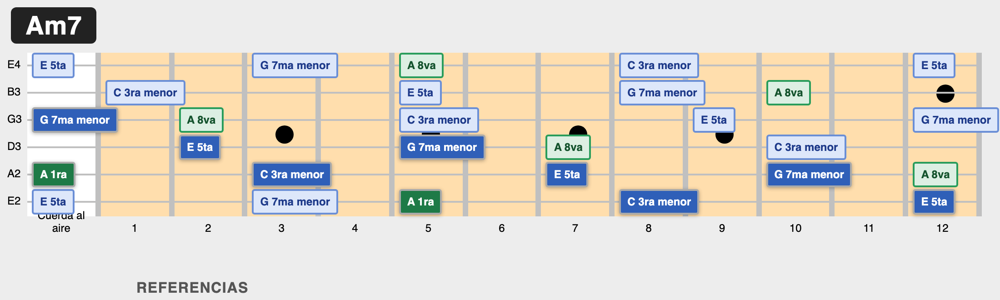

# Analizador Musical 🎸

[](https://github.com/ycantill/music-analyser/actions/workflows/ci.yml)
[](https://ycantill.github.io/music-analyser/)


> **English:** an interactive guitar fretboard for learning musical intervals
> and chords by exploring, seeing and hearing them. Built as a Personal
> Learning Environment (PLE) during my pedagogy training at SENA (Colombia).
> See the [technical summary](#technical-summary) below.

Entorno personal de aprendizaje (PLE) para explorar los **intervalos** y los
**acordes** en el mástil de la guitarra: se ven, se oyen y se construyen nota
por nota.

**[Abrir la app →](https://ycantill.github.io/music-analyser/)** (funciona en el celular, mejor en horizontal, y sin internet después de abrirla una vez)



## Qué hace

- Muestra el **mástil completo**: 6 cuerdas en afinación estándar, de la cuerda al aire al traste 12.
- Al tocar una nota, esa nota es la **tónica** (en verde) y todas las demás muestran su **intervalo** respecto a ella.
- Al tocar más notas se arma un **acorde** (en azul). La app lo nombra (Am, C7, Dmaj9…) y lo hace sonar.
- Las notas de la tónica y del acorde en otras posiciones del mástil quedan resaltadas en un tono claro, para ver el mismo patrón en todo el diapasón.
- **Capturar diapasón** guarda una imagen para compartirla desde el celular.
- **Funciona sin internet** después de la primera visita, sonido incluido. Se puede agregar a la pantalla de inicio del celular como una app.

## Propuesta pedagógica

La creé como mi PLE durante mi formación en pedagogía en el SENA: una
herramienta propia para aprender teoría musical **explorando**, que después
sirve para enseñarla.

### Por qué así

- **Aprender haciendo.** La teoría (intervalo, tónica, acorde) aparece cuando
  la persona toca el mástil, no antes. Primero explora, después nombra.
- **Varios sentidos a la vez.** Cada nota se **ve** en su lugar, se **oye** y
  se **nombra**. El nombre del intervalo y el sonido llegan juntos.
- **Retroalimentación inmediata.** Cada toque cambia lo que muestra el
  diapasón y el nombre del acorde, sin esperar a que alguien corrija.
- **De lo simple a lo complejo.** Una nota (tónica) → dos notas (intervalo) →
  tres o más (acorde). Cada paso usa lo que se entendió en el anterior.
- **Del sonido a la ciencia.** La [tabla de intervalos](#los-intervalos)
  relaciona cada uno con su razón de frecuencias: las más simples (2:1, 3:2)
  son las que suenan más consonantes, como explican las referencias de abajo.

### Objetivos de aprendizaje

Después de usarla, la persona puede:

1. **Ubicar** en el mástil los intervalos de una tónica (tercera, quinta, octava…) en distintas posiciones.
2. **Reconocer de oído** la diferencia entre intervalos consonantes y disonantes.
3. **Construir** tríadas mayores y menores, y acordes de séptima, a partir de sus intervalos.
4. **Explicar** por qué la octava y la quinta suenan "estables": sus razones de frecuencia son simples (2:1 y 3:2).

### Cómo usarla en una clase (sugerencia de 45 minutos)

| Momento | Actividad | Evidencia |
|---|---|---|
| Exploración (10 min) | Tocar notas libremente y describir qué cambia en el diapasón. | Lo que cada quien descubrió, en voz alta o en el chat. |
| Reto (10 min) | Elegir La (A) como tónica y encontrar su quinta justa en tres lugares del mástil. | Capturas del diapasón. |
| Construcción (15 min) | Armar Am, A y A7 sumando notas, y escuchar qué cambia con cada una. | El nombre del acorde que muestra la app en cada paso. |
| Cierre (10 min) | Comparar con la tabla: ¿por qué la quinta suena más estable que la segunda menor? | Una explicación corta con la razón de frecuencias. |

El botón **Capturar diapasón** sirve para que cada aprendiz guarde y comparta
su trabajo como evidencia de aprendizaje.

### Accesibilidad e inclusión

La app cumple las pautas **WCAG 2.2 nivel AA**, y una prueba automática las
revisa en cada cambio:

- Se puede usar **solo con el teclado**: cada nota es un botón y el foco se ve.
- Funciona con **lector de pantalla**: cada nota dice su nombre, su cuerda, su traste y su intervalo (por ejemplo, "E 3ra: E3, cuerda 4, traste 2, tercera mayor"), y el acorde se anuncia cuando cambia.
- Los colores tienen **contraste suficiente** y la información no depende solo del color: cada nota también tiene su nombre escrito.
- **Funciona sin conexión:** basta abrirla una vez con internet (por ejemplo, en casa o en el aula antes de la clase) para usarla después en un lugar con mala señal.

### Los intervalos

| Intervalo | En el diapasón | Semitonos | Razón (afinación justa) |
|---|---|:-:|:-:|
| Unísono | 1ra | 0 | 1:1 |
| Segunda menor | 2da menor | 1 | 16:15 |
| Segunda mayor | 2da | 2 | 9:8 |
| Tercera menor | 3ra menor | 3 | 6:5 |
| Tercera mayor | 3ra | 4 | 5:4 |
| Cuarta justa | 4ta | 5 | 4:3 |
| Quinta disminuida (tritono) | 5ta dim | 6 | 45:32 |
| Quinta justa | 5ta | 7 | 3:2 |
| Sexta menor | 6ta menor | 8 | 8:5 |
| Sexta mayor | 6ta | 9 | 5:3 |
| Séptima menor | 7ma menor | 10 | 16:9 |
| Séptima mayor | 7ma | 11 | 15:8 |
| Octava | 8va | 12 | 2:1 |

La guitarra usa afinación temperada (cada semitono multiplica la frecuencia
por ¹²√2), así que estas razones son aproximadas. Una prueba automática
verifica que ninguna se aleje más de un cuarto de semitono.

## Referencias

- Chase, W. *How music really works!* Roedy Black Publishing. https://www.howmusicreallyworks.com
- Roos, F. (2020). *Pure intervals*. Loophole Letters. https://loophole-letters.vercel.app/intervals
- Shapira Lots, I., y Stone, L. (2008). Perception of musical consonance and dissonance: An outcome of neural synchronization. *Journal of the Royal Society Interface, 5*(29), 1429–1434. https://pmc.ncbi.nlm.nih.gov/articles/PMC2607353/

## Desarrollo

```bash
npm install
npm run dev        # servidor de desarrollo
npm run lint       # ESLint
npm test           # pruebas de la teoría musical (Vitest)
npm run test:e2e   # accesibilidad y uso con teclado (Playwright + axe)
npm run build      # build de producción
```

Cada pull request pasa por lint, pruebas, build y pruebas E2E. Solo lo que
llega a `main` se publica en GitHub Pages.

## Technical summary

| | |
|---|---|
| UI | React 19 + Vite 8, plain CSS |
| Audio | [Tone.js](https://tonejs.github.io/): a pool of triangle-wave synths with reverb, so a whole chord sounds at once. Loaded on the first tap, which keeps the initial JavaScript at ~235 kB instead of ~775 kB. |
| Music theory | Pure functions in `src/core`: equal-temperament frequencies from A4 = 440 Hz, the interval between any two notes, and chord detection by matching interval sets (octave doublings and order ignored). |
| Accessibility | Every fret position is a `<button>` with an accessible name that starts with its visible label (WCAG 2.5.3), `aria-pressed` for selected notes, an `aria-live` region for the chord, visible focus and 5:1+ contrast. |
| Testing | 21 unit tests (Vitest) for the theory core; 6 end-to-end tests (Playwright) that build a chord with the keyboard only, run axe-core (WCAG 2.2 AA), check the PWA manifest and **play a chord with the network off**. |
| CI/CD | GitHub Actions: lint, tests, build and E2E on every pull request; deploy to GitHub Pages only from `main`. |
| PWA | Installable and **offline-first**: a Workbox service worker (`vite-plugin-pwa`) precaches the whole build, including the lazily loaded Tone.js chunk, so sound works offline too. The manifest uses relative paths so it works under `/music-analyser/`. |
